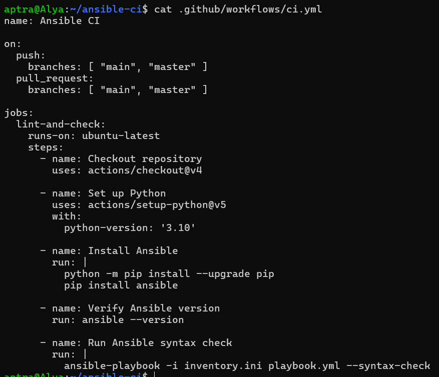
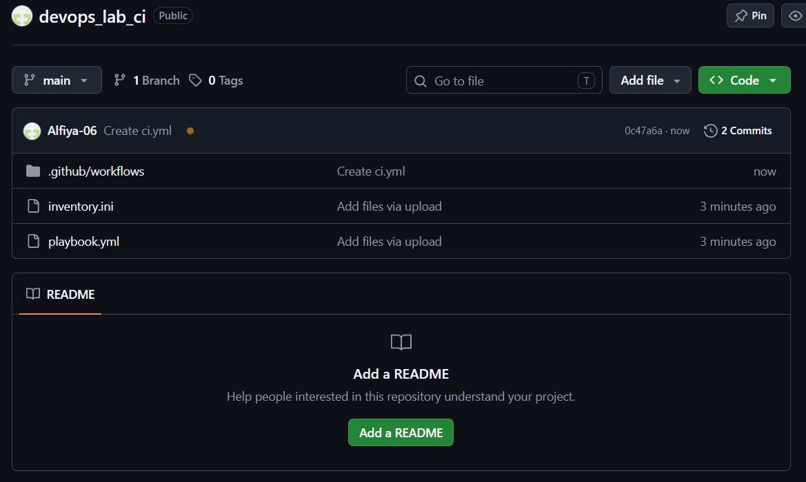
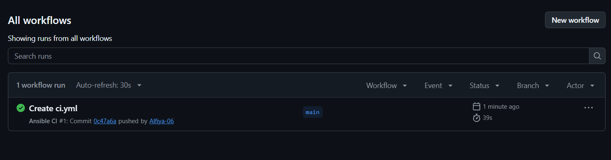
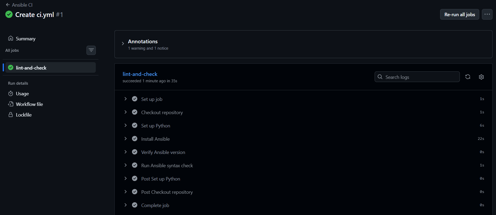

# Лабораторная работа П07-2: Добавление функций CI

**Выполнила:** Аптракова Альфия, студентка группы ИТ-1-2024 

---

## Цель работы

Освоить базовые принципы непрерывной интеграции (CI), настроить автоматический пайплайн проверки кода с помощью **GitHub Actions** для конфигураций Ansible.

---

## Что было сделано

1. Подготовлена рабочая директория в окружении WSL (Ubuntu) и перенесены файлы плейбука (`playbook.yml`) и инвентаря (`inventory.ini`).
2. Создана структура директорий `.github/workflows/` для конфигурации GitHub Actions.
3. Разработан YAML-файл пайплайна (`ci.yml`), который автоматически при каждом пуше поднимает виртуальное окружение Ubuntu, устанавливает Python и Ansible, проверяет версию и выполняет синтаксическую проверку плейбука (`--syntax-check`).
4. Проект выгружен в публичный репозиторий GitHub, успешно пройден автоматический CI-тест.

---

## Структура проекта

- `.github/workflows/ci.yml` — конфигурационный файл GitHub Actions пайплайна.
- `playbook.yml` — Ansible-плейбук для проверки.
- `inventory.ini` — файл инвентаря.
- `screenshots/` — директория со скриншотами выполнения.

---

## Скриншоты выполнения

- **Содержимое файла конфигурации CI (`ci.yml`):**
  

- **Структура файлов проекта в репозитории GitHub:**
  

- **Успешный статус выполнения пайплайна во вкладке Actions:**
  

- **Логи успешного прохождения проверки синтаксиса:**
  

---

## Вывод

В ходе лабораторной работы был успешно настроен пайплайн непрерывной интеграции (CI) на базе GitHub Actions. Это позволяет автоматически валидировать синтаксис Ansible-плейбуков при любых изменениях в репозитории, исключая появление базовых ошибок в коде до этапа развертывания.
